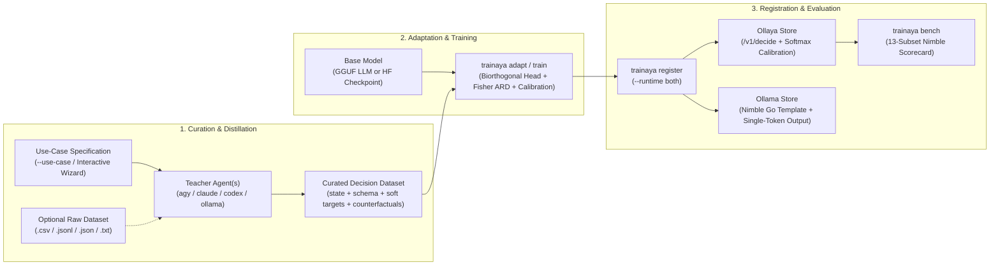

<div align="center">
  <h1>Trainaya</h1>
  <p><strong>Model Adaptation, Teacher Distillation, and Fine-Tuning Toolchain for <a href="https://github.com/solarpush/ollaya">Ollaya</a> and <a href="https://ollama.com">Ollama</a></strong></p>

  <p>
    <a href="https://github.com/solarpush/trainaya/releases"></a>
    <a href="https://github.com/solarpush/trainaya/blob/main/LICENSE"></a>
    
    
  </p>
</div>

---

**Trainaya** is a single-binary Rust CLI backed by a self-bootstrapping `uv` + PyTorch + `libllama.so.0` engine (ROCm, CUDA, Metal, and SIMD CPU). It turns domain use-cases and off-the-shelf GGUF or HuggingFace models into calibrated, single-forward-pass **System-1 Decision Models** (`choice`, `noul`, and `score`).

## Overview

| Capability | Command | Description |
| :--- | :--- | :--- |
| **Use-Case Curation & Distillation** | `trainaya curate` | Interactive wizard and declarative `.Curatefile` engine that distills frontier Teacher Agents (`agy`, `claude`, `codex`, `gemini`, `ollama`, `ollaya`) to synthesize domain datasets or reformat raw CSV/JSONL/JSON/TXT files into calibrated training records. |
| **Zero-Overhead Model Adaptation** | `trainaya adapt` | Converts causal GGUF LLMs (`Ministral`, `Gemma-3`, `Qwen`, `Llama`) or HuggingFace checkpoints (`ModernBERT`, `DeBERTa`, `Gemma-2`) into calibrated decision models (`llm-logits-v1` / `laya-markers-v1`) via untied output-head grafting, biorthogonal template projection, Fisher ARD kernel regression, and per-primitive temperature scaling. |
| **Dual Runtime Registration** | `trainaya register` | Zero-copy registration into **Ollaya**, **Ollama**, or **both** (`--runtime auto \| ollaya \| ollama \| both`) using hard-linked content-addressable blobs and a deterministic Nimble Go template (`temperature 0`, `num_predict 1`). |
| **End-to-End Fine-Tuning** | `trainaya train` | Full encoder and LoRA/QLoRA fine-tuning driven by `.Trainfile` recipes with soft-target KL distillation and automatic semantic version tagging (`v{ patch + 1 }`). |
| **Nimble Calibration Benchmark** | `trainaya bench` | Evaluates Macro Accuracy, Public Skill, Macro/Pooled ECE, Brier Score, and p50/p95 latency across the 13 [`bespokelabsai/nimble`](https://huggingface.co/datasets/bespokelabsai/nimble) (`bench.ollaya.dev`) decision subsets. |

---

## Architecture



---

## Installation

### Prebuilt Binary (Linux & macOS)

```bash
curl -fsSL https://raw.githubusercontent.com/solarpush/trainaya/main/install.sh | sh
```

### Build from Source

```bash
git clone https://github.com/solarpush/trainaya.git
cd trainaya
cargo build --release
./target/release/trainaya doctor
```

On first execution, Trainaya automatically provisions its embedded Python engine inside `~/.cache/trainaya/py_engine` via `uv` and configures the appropriate hardware backend (AMD ROCm/HIP, NVIDIA CUDA, Apple Metal, or CPU).

---

## 1. Use-Case Dataset Curation (`trainaya curate`)

`trainaya curate` builds training datasets around a **Use-Case specification** and **Teacher Agent distillation**, either by synthesizing examples from scratch or by reformatting an existing raw dataset into canonical decision records.

### Interactive Mode

Run `trainaya curate` without arguments to launch the interactive terminal wizard:

```bash
trainaya curate
```

The wizard walks through six steps:
1. **Use-Case Description**: Define in free text what the final model must decide, domain policies, and boundary conditions.
2. **Workflow Selection**:
   - `synth`: Generate the decision schema (`choice`, `noul`, or `score`) and synthesize a balanced training dataset with counterfactual hard-negative twins directly from the Use-Case description.
   - `reformat`: Load an existing dataset (`.jsonl`, `.csv`, `.tsv`, `.json`, `.txt`) and use the Teacher Agent to reformat its columns or fields into structured `state` + `question` + `options` + calibrated soft `target` probabilities.
   - `augment`: Reformat an existing dataset and generate minimally perturbed counterfactual twins (`hard_negative` + `hard_negative_label`) where flipping a single causal fact flips the decision.
3. **Input Dataset Path**: Required when running in `reformat` or `augment` mode.
4. **Teacher Agent**: Select from auto-detected local CLIs (`agy`, `claude`, `codex`, `gemini`), local model daemons (`ollama:<model>`, `ollaya:<model>`), or comma-separated multi-teacher consensus (`agy, claude`).
5. **Decision Primitive & Schema**: Choose `choice`, `noul`, or `score`. If no `--schema` file is supplied, the Teacher Agent synthesizes the schema automatically from the Use-Case and writes it to `<output>.schema.json`.
6. **Persistence**: Optionally save the configuration to `.Curatefile` for reproducible non-interactive execution.

### CLI Usage

```bash
# Synthesize a domain dataset and decision schema directly from a Use-Case description
trainaya curate \
  --use-case "Triage incoming SaaS support tickets into refund, technical_bug, billing_question, security_alert, or general" \
  --teacher agy \
  --mode synth \
  --kind choice \
  --count 100 \
  --output ./data/support_triage.jsonl

# Reformat and distill an existing CSV dataset for a specific Use-Case
trainaya curate \
  --use-case "Verify whether a clinical abstract's conclusion is directly established by the reported trial evidence" \
  --teacher claude \
  --mode reformat \
  --kind noul \
  --input ./data/raw_clinical_notes.csv \
  --output ./data/clinical_verified.jsonl
```

### Declarative `.Curatefile`

```dockerfile
# .Curatefile
USE_CASE "Triage incoming customer support tickets into actionable routing categories (refund, technical_help, billing_question, security_incident, general)"
TEACHER agy, claude
MODE synth
FORMAT decision
KIND choice
OUTPUT ./data/curated_train.jsonl
COUNT 50

PARAMETER batch_size 10
PARAMETER min_confidence 0.85
PARAMETER add_hard_negatives true
```

Execute non-interactively with:

```bash
trainaya curate --non-interactive
```

---

## 2. Model Adaptation (`trainaya adapt`)

`trainaya adapt` converts off-the-shelf GGUF causal LLMs (`Ministral`, `Gemma-3`, `Llama`, `Qwen`) or HuggingFace models into calibrated decision models (`llm-logits-v1` or `laya-markers-v1`):

1. **Untied Output-Head Grafting**: When a GGUF checkpoint uses tied embeddings (`token_embd.weight` without a standalone `output.weight`, such as `Gemma-3` or `Ministral-3B`), Trainaya materializes an independent `F16` `output.weight` tensor so the 31 decision rows (`<A>`..`<Z>` and `0`..`4`) can be updated without altering backbone representations.
2. **Biorthogonal Dual Template Basis (`U` & `U_s`)**: Projects out prompt-template prior biases across both the 26 categorical letter tokens (`<A>`..`<Z>`) and the 5 ordinal rubric tokens (`0`..`4`).
3. **Fisher-Preconditioned ARD Kernel Ridge**: Fits a non-linear Nyström RBF + polynomial decision head over `libllama.so.0` pre-final hidden states and distills the resulting projection back into `output.weight`.
4. **Per-Primitive Temperature Scaling**: Optimizes `T_choice`, `T_noul`, and `T_score` via held-out NLL minimization and writes `decision.json` and `calibration.json`.

```bash
# Adapt a GGUF model and register it into both Ollaya and Ollama
trainaya adapt \
  --from ministral-8b.gguf \
  -t push_ministral:8b \
  --runtime both \
  --output-dir ./output/push_ministral_8b

# Adapt a model on a custom dataset produced by 'trainaya curate'
trainaya adapt \
  --from gemma-3-4b-it.gguf \
  -t custom_triage:4b \
  --data ./data/curated_train.jsonl \
  --runtime both
```

---

## 3. Dual Runtime Registration (`trainaya register`)

Adapted or fine-tuned models can be registered into **Ollaya**, **Ollama**, or **both** (`--runtime auto | ollaya | ollama | both`):

```bash
trainaya register \
  --model ./output/push_ministral_8b \
  --name push_ministral:8b \
  --runtime both
```

- **Ollaya (`/v1/decide`)**: Links the GGUF/SafeTensors weights alongside `decision.json` and `calibration.json` for single-pass calibrated probability extraction over `<A>`..`<Z>` and `0`..`4`.
- **Ollama (`ollama run <tag>`)**: Emits an OCI manifest with a Go template matching the exact Ollaya/Nimble decision prompt format and deterministic single-token decoding parameters (`temperature 0`, `top_k 1`, `num_predict 1`).

---

## 4. Benchmarking & Calibration (`trainaya bench`)

`trainaya bench` evaluates models against the 13 [`bespokelabsai/nimble`](https://huggingface.co/datasets/bespokelabsai/nimble) (`bench.ollaya.dev`) public benchmark subsets (`50` probes per subset, `650` probes total), reporting **Macro Accuracy**, **Public Skill**, **Macro ECE**, **Pooled ECE**, **Brier Score**, and **p50/p95 Latency**:

```bash
trainaya bench --model push_ministral:8b --baseline winnow:e4b --limit 50
```

### Reference Scorecard (650 Probes — 13 Nimble Subsets)

| Metric / Subset | Primitive | `winnow:e4b` *(Reference)* | **`push_ministral:8b`** *(Adapted 8B)* | **`push_ministral:3b`** *(Adapted 3B)* | **`push_gemma3:4b`** *(Adapted 4B)* |
| :--- | :---: | :---: | :---: | :---: | :---: |
| **Macro Accuracy** | *All (13)* | `80.8%` | **`69.1%`** | **`66.9%`** | **`56.9%`** |
| **Public Skill** | *0..100* | `70.1` | **`52.2`** | **`48.8`** | **`33.6`** |
| **Macro ECE** *(lower is better)* | *Calibration* | `0.133` | **`0.125`** | `0.165` | `0.219` |
| **Pooled ECE** *(lower is better)* | *Calibration* | `0.083` | **`0.046`** | `0.120` | `0.143` |
| **Choice Family** | `choice` | `84.8%` | **`71.2%`** | **`68.8%`** | **`52.4%`** |
| **Noul Family** | `noul` | `81.2%` | **`74.0%`** | **`72.0%`** | **`65.2%`** |
| **Score Family** | `score` | `72.0%` | **`57.3%`** | **`55.3%`** | **`50.7%`** |
| `boolq` | `noul` | `80.0%` | **`90.0%`** | `84.0%` | **`94.0%`** |
| `aegis2` | `noul` | `84.0%` | **`84.0%`** | `82.0%` | `64.0%` |
| `summeval-consistency` | `noul` | `78.0%` | **`80.0%`** | `76.0%` | **`78.0%`** |
| `massive-en-US` | `choice` | `82.0%` | `78.0%` | **`80.0%`** | `62.0%` |
| `massive-de-DE` | `choice` | `82.0%` | **`80.0%`** | `72.0%` | `58.0%` |
| `multinli` | `choice` | `84.0%` | `66.0%` | `60.0%` | **`74.0%`** |
| **Latency (p50)** | *ms* | `44 ms` | `92 ms` | **`52 ms`** | `72 ms` |

---

## 5. End-to-End Fine-Tuning (`trainaya train`)

For encoder architectures (`answerdotai/ModernBERT-base`, `microsoft/deberta-v3-base`) or full PyTorch LoRA training, define a `.Trainfile` and run `trainaya train`:

```dockerfile
# .Trainfile
FROM answerdotai/ModernBERT-base
TASK decision
DATA ./data/curated_train.jsonl

PARAMETER epochs 8
PARAMETER batch_size 8
PARAMETER lr 1.5e-4
PARAMETER max_length 512

OUTPUT ./output/{tag}
REGISTER custom-decider:v{ patch + 1 }
```

```bash
trainaya train
```

---

## CLI Reference

| Command | Summary |
| :--- | :--- |
| `trainaya curate` | Interactive wizard and `.Curatefile` engine for Use-Case definition, Teacher Agent distillation, and dataset reformatting |
| `trainaya adapt` | Adapt any GGUF or HuggingFace model into a calibrated decision model and register it into Ollaya and/or Ollama |
| `trainaya train` | Fine-tune an encoder or LoRA decision model end-to-end from a `.Trainfile` or `--data` |
| `trainaya register` | Zero-copy register a model directory or GGUF bundle into `ollaya`, `ollama`, or `both` |
| `trainaya bench` | Run the 13-subset Nimble decision benchmark with calibration metrics and SHA-256 digest caching |
| `trainaya merge` | Permanently fuse LoRA adapter weights into base SafeTensors or GGUF weights |
| `trainaya export` | Package a trained model into SafeTensors, GGUF, or ONNX with `decision.json` and `calibration.json` |
| `trainaya doctor` | Inspect CPU/GPU hardware, ROCm/CUDA/Metal acceleration, and the embedded `uv` + PyTorch engine |
| `trainaya update` | Self-update the `trainaya` binary from GitHub Releases |

---

## License

Dual-licensed under **MIT** or **Apache-2.0** at your option.
