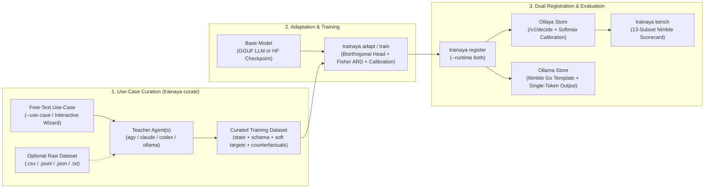

<div align="center">
  <h1>⚡ Trainaya</h1>
  <p><strong>Rust CLI & Embedded PyTorch Engine for Adapting, Curating, Training, and Benchmarking System-1 Decision Models for <a href="https://github.com/SargeDev/ollaya">Ollaya</a> & <a href="https://ollama.com">Ollama</a></strong></p>

  <p>
    <a href="https://github.com/SargeDev/trainaya/releases"></a>
    <a href="https://github.com/SargeDev/trainaya/blob/main/LICENSE"></a>
    
    
  </p>
</div>

---

**Trainaya** is the unified model toolchain for the **Ollaya** ecosystem (and standard **Ollama**). It combines a single-binary **Rust CLI** with a self-bootstrapping **uv + PyTorch + `libllama.so.0` (ROCm / CUDA / Metal / CPU)** engine to turn raw domain use-cases and off-the-shelf foundation models into calibrated, single-forward-pass **System-1 Decision Models** (`choice`, `noul`, and `score`).

### ✨ Core Capabilities

- **🧭 Interactive Use-Case Curation & Teacher Distillation (`trainaya curate`)**: Describe your target Use-Case in free text, select a Teacher Agent (`agy`, `claude`, `codex`, `gemini`, `ollama:<model>`, `ollaya:<model>`, or multi-teacher consensus), and either **synthesize a complete tailored dataset + schema** or **reformat & distill an existing dataset** (`.jsonl`, `.csv`, `.json`, `.txt`) into ready-to-train decision records with calibrated soft target probabilities and counterfactual hard-negative twins.
- **🧬 Zero-Overhead GGUF & HuggingFace Model Adaptation (`trainaya adapt`)**: Convert any GGUF causal LLM (`Ministral-8B`, `Ministral-3B`, `Gemma-3-4B`, `Qwen`, `Llama`) or HuggingFace model (`ModernBERT`, `DeBERTa`, `Gemma-2`) into a calibrated decision model (`llm-logits-v1` or `laya-markers-v1`) via **GGUF Untied Output Head Grafting**, **Biorthogonal Dual Template Basis (`U` & `U_s`)**, **Fisher ARD Kernel Projection**, and **Per-Primitive Temperature Scaling**.
- **📦 Dual Zero-Copy Runtime Registration (`trainaya register`)**: Register adapted or fine-tuned models into **Ollaya**, **Ollama**, or **both simultaneously** (`--runtime auto | ollaya | ollama | both`) using zero-copy hard-linked blobs and an Ollama Go template aligned 100% with the Nimble/Ollaya decision prompt (`temperature 0`, `num_predict 1`).
- **🏋️ Declarative End-to-End Fine-Tuning (`trainaya train`)**: Fine-tune encoder backbones (`ModernBERT`, `DeBERTa`) or LoRA/QLoRA adapters via `.Trainfile` recipes with soft-target KL distillation and dynamic version tags (`v{ patch + 1 }`).
- **📊 13-Subset Nimble Benchmark & Calibration Scorecard (`trainaya bench`)**: Evaluate accuracy, Macro/Pooled ECE, Brier score, Public Skill, and p50/p95 latency across the 13 official [`bespokelabsai/nimble`](https://huggingface.co/datasets/bespokelabsai/nimble) (`bench.ollaya.dev`) benchmark subsets.

---

## 🏗️ End-to-End Workflow Architecture



---

## 📦 Installation & Diagnostics

### One-Liner Install (Linux & macOS)

```bash
curl -fsSL https://raw.githubusercontent.com/SargeDev/trainaya/main/install.sh | sh
```

### Build from Source

```bash
git clone https://github.com/SargeDev/trainaya.git
cd trainaya
cargo build --release
./target/release/trainaya doctor
```

On first execution of `trainaya doctor`, `trainaya adapt`, or `trainaya train`, Trainaya automatically provisions an isolated Python environment in `~/.cache/trainaya/py_engine` via `uv` and detects your hardware accelerator (AMD ROCm/HIP, NVIDIA CUDA, Apple Metal, or SIMD CPU).

---

## 🧭 1. Interactive Use-Case Curation & Dataset Reformatting (`trainaya curate`)

Instead of overfitting to benchmark test sets, `trainaya curate` starts from **your real-world Use-Case** and **distills a frontier Teacher Agent** to produce high-signal training data (with calibrated soft target distributions and counterfactual twins) ready for `trainaya adapt` or `trainaya train`.

### Option A: Launch the Interactive Wizard

Simply run `trainaya curate` (or `trainaya curate -i`) in your terminal:

```bash
trainaya curate
```

The interactive wizard guides you step by step:
1. **Use-Case Description**: Explain in plain language what your final model must decide, domain constraints, and edge cases.
2. **Workflow Mode**:
   - `[1] synth`: Generate both the decision schema (`choice`, `noul`, or `score`) and a complete synthetic + counterfactual dataset directly from your Use-Case description.
   - `[2] reformat`: Provide an existing raw dataset (`.jsonl`, `.csv`, `.tsv`, `.json`, `.txt`) and let the Teacher Agent reformat its columns/fields into structured `state` + `question` + `options` + calibrated `target` probabilities tailored to your Use-Case.
   - `[3] augment`: Reformat an existing dataset and synthesize minimally perturbed **Counterfactual Twins** (`hard_negative` + `hard_negative_label`) where flipping one causal detail flips the decision.
3. **Teacher Agent**: Pick from auto-detected local CLIs (`agy`, `claude`, `codex`, `gemini`), local daemons (`ollama:<model>`, `ollaya:<model>`), or multi-teacher consensus (`agy, claude`).
4. **Save to `.Curatefile`**: Optionally persist your interactive answers into a reproducible `.Curatefile`.

### Option B: CLI One-Liners

```bash
# 1. Synthesize a complete dataset & schema directly from a free-text Use-Case using 'agy'
trainaya curate \
  --use-case "Triage incoming SaaS support tickets into refund, technical_bug, billing_question, security_alert, or general" \
  --teacher agy \
  --mode synth \
  --kind choice \
  --count 100 \
  --output ./data/support_triage.jsonl

# 2. Reformat & distill an existing CSV/JSONL dataset for your Use-Case using 'claude'
trainaya curate \
  --use-case "Verify whether a clinical abstract's conclusion is directly supported by the reported trial results" \
  --teacher claude \
  --mode reformat \
  --kind noul \
  --input ./data/raw_clinical_notes.csv \
  --output ./data/clinical_verified.jsonl
```

### Option C: Declarative `.Curatefile`

```dockerfile
# .Curatefile
USE_CASE "Triage incoming customer support tickets into actionable routing categories (refund, technical_help, billing_question, security_incident, general)"
TEACHER agy, claude
MODE synth
FORMAT decision
KIND choice
OUTPUT ./data/curated_train.jsonl
COUNT 50

PARAMETER batch_size 10
PARAMETER min_confidence 0.85
PARAMETER add_hard_negatives true
```

Run non-interactively with:
```bash
trainaya curate --non-interactive
```

---

## 🧬 2. Adapting GGUF & HuggingFace Models (`trainaya adapt`)

`trainaya adapt` converts any standard GGUF causal LLM (`Ministral`, `Gemma-3`, `Llama`, `Qwen`) or HuggingFace model into a zero-overhead decision model (`llm-logits-v1` or `laya-markers-v1`) without requiring full-model backpropagation:

1. **GGUF Untied Output Head Grafting**: If the source GGUF shares tied embeddings (`token_embd.weight` without `output.weight`, such as `Gemma-3` or `Ministral-3B`), Trainaya materializes an independent `F16` `output.weight` tensor so the 31 decision rows (`<A>`..`<Z>` and `0`..`4`) can be surgically replaced in-place while preserving 100% of the backbone weights.
2. **Biorthogonal Dual Template Basis (`U` & `U_s`)**: Eliminates template-induced prior bias across both the 26 letter tokens (`<A>`..`<Z>`) and the 5 numeric rubric tokens (`0`..`4`) on arbitrary prompt formats.
3. **Fisher-Preconditioned ARD Kernel Ridge**: Learns a non-linear Nyström RBF + polynomial decision head over `libllama.so.0` pre-final hidden states and distills it back into the exact rows of `output.weight`.
4. **Per-Primitive Temperature Scaling**: Optimizes `T_choice`, `T_noul`, and `T_score` via NLL minimization and writes `calibration.json` + `decision.json`.

```bash
# Adapt a local GGUF or Ollaya/Ollama model and register into BOTH Ollaya and Ollama
trainaya adapt \
  --from ministral-8b.gguf \
  -t push_ministral:8b \
  --runtime both \
  --output-dir ./output/push_ministral_8b

# Adapt a model specialized on your curated Use-Case dataset
trainaya adapt \
  --from gemma-3-4b-it.gguf \
  -t custom_triage:4b \
  --data ./data/curated_train.jsonl \
  --runtime both
```

---

## 📦 3. Dual Registration for Ollaya & Ollama (`trainaya register`)

Every adapted or trained model can be registered into **Ollaya**, **Ollama**, or **both** (`--runtime auto | ollaya | ollama | both`):

```bash
trainaya register \
  --model ./output/push_ministral_8b \
  --name push_ministral:8b \
  --runtime both
```

- **In Ollaya (`/v1/decide`)**: Uses zero-copy hard-linked blobs (`model` + `decision.json` + `calibration.json`) to extract the exact log-probabilities over `<A>`..`<Z>` or `0`..`4` in a single forward pass.
- **In Ollama (`ollama run <tag>`)**: Generates an OCI manifest with a Go template matching the exact Ollaya/Nimble prompt structure and deterministic single-token parameters (`temperature 0`, `top_k 1`, `num_predict 1`).

---

## 📊 4. Benchmarking on the 13 Nimble Subsets (`trainaya bench`)

`trainaya bench` evaluates any Ollaya model across the 13 official [`bespokelabsai/nimble`](https://huggingface.co/datasets/bespokelabsai/nimble) (`bench.ollaya.dev`) subsets (`50` probes per subset, `650` probes total), computing **Macro Accuracy**, **Public Skill**, **Macro ECE**, **Pooled ECE**, **Brier Score**, and **p50/p95 Latency**:

```bash
# Full 13-subset Nimble scorecard vs winnow:e4b baseline
trainaya bench --model push_ministral:8b --baseline winnow:e4b --limit 50
```

### Reference Benchmark Results (650 Probes — 13 Nimble Subsets)

| Metric / Subset | Kind | `winnow:e4b` *(Reference)* | **`push_ministral:8b`** *(Adapted 8B)* | **`push_ministral:3b`** *(Adapted 3B)* | **`push_gemma3:4b`** *(Adapted 4B)* |
| :--- | :---: | :---: | :---: | :---: | :---: |
| **Macro Accuracy** | *All (13)* | `80.8%` | **`69.1%`** | **`66.9%`** | **`56.9%`** |
| **Public Skill** | *0..100* | `70.1` | **`52.2`** | **`48.8`** | **`33.6`** |
| **Macro ECE** *(↓ better)* | *Calib* | `0.133` | **`0.125`** ✅ | `0.165` | `0.219` |
| **Pooled ECE** *(↓ better)* | *Calib* | `0.083` | **`0.046`** ✅ | `0.120` | `0.143` |
| **Choice Family** | `choice` | `84.8%` | **`71.2%`** | **`68.8%`** | **`52.4%`** |
| **Noul Family** | `noul` | `81.2%` | **`74.0%`** | **`72.0%`** | **`65.2%`** |
| **Score Family** | `score` | `72.0%` | **`57.3%`** | **`55.3%`** | **`50.7%`** |
| `boolq` | `noul` | `80.0%` | **`90.0%`** ✅ | `84.0%` ✅ | **`94.0%`** 🏆 |
| `aegis2` | `noul` | `84.0%` | **`84.0%`** 🤝 | `82.0%` | `64.0%` |
| `summeval-consistency` | `noul` | `78.0%` | **`80.0%`** ✅ | `76.0%` | **`78.0%`** 🤝 |
| `massive-en-US` | `choice` | `82.0%` | `78.0%` | **`80.0%`** | `62.0%` |
| `massive-de-DE` | `choice` | `82.0%` | **`80.0%`** | `72.0%` | `58.0%` |
| `multinli` | `choice` | `84.0%` | `66.0%` | `60.0%` | **`74.0%`** |
| **Latency (p50)** | *ms* | `44 ms` | `92 ms` | **`52 ms`** ⚡ | `72 ms` |

---

## 🏋️ 5. End-to-End Fine-Tuning (`trainaya train`)

For encoder architectures (`answerdotai/ModernBERT-base`, `microsoft/deberta-v3-base`) or full PyTorch LoRA training, configure a `.Trainfile` and run `trainaya train`:

```dockerfile
# .Trainfile
FROM answerdotai/ModernBERT-base
TASK decision
DATA ./data/curated_train.jsonl

PARAMETER epochs 8
PARAMETER batch_size 8
PARAMETER lr 1.5e-4
PARAMETER max_length 512

OUTPUT ./output/{tag}
REGISTER custom-decider:v{ patch + 1 }
```

```bash
trainaya train
```

---

## 🛠️ CLI Reference Summary

| Command | Description |
| :--- | :--- |
| `trainaya curate` | Interactive wizard (or `.Curatefile` / CLI) to define a Use-Case, distill a Teacher Agent (`agy`, `claude`, `ollama`), and synthesize or reformat training data |
| `trainaya adapt` | Adapt any GGUF or HuggingFace model into a calibrated decision model and register it into Ollaya/Ollama |
| `trainaya train` | Fine-tune an encoder or LoRA decision model end-to-end from a `.Trainfile` or `--data` |
| `trainaya register` | Zero-copy register a model directory or GGUF bundle into `ollaya`, `ollama`, or `both` |
| `trainaya bench` | Run the 13-subset Nimble decision benchmark with calibration metrics and SHA-256 result caching |
| `trainaya merge` | Permanently fuse LoRA adapter weights into base SafeTensors or GGUF weights |
| `trainaya export` | Package a trained model into SafeTensors, GGUF, or ONNX with `decision.json` and `calibration.json` |
| `trainaya doctor` | Inspect CPU/GPU hardware, ROCm/CUDA/Metal acceleration, and the embedded `uv` + PyTorch engine |
| `trainaya update` | Self-update the `trainaya` binary from GitHub Releases |

---

## 📄 License

Dual-licensed under **MIT** or **Apache-2.0** at your option.
